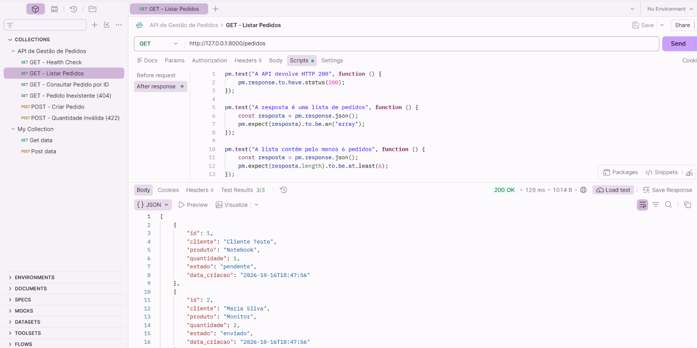
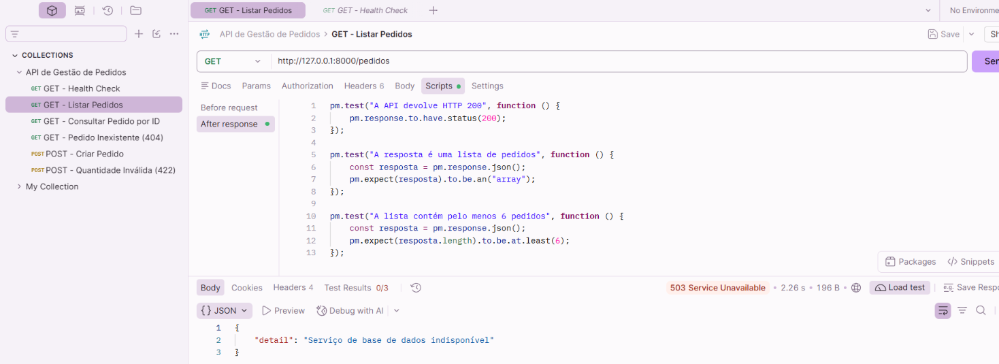
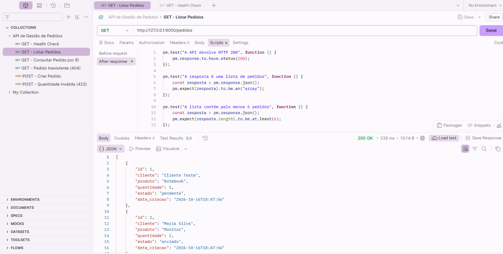

# Evidências Técnicas — API Troubleshooting Lab

## Sobre esta Pasta

Esta pasta reúne as evidências técnicas produzidas durante o desenvolvimento, os testes e a investigação de incidentes do projeto **API Troubleshooting Lab**.

O laboratório simula atividades de Suporte Aplicacional num ambiente de comércio eletrónico, utilizando Python, FastAPI, MySQL e Postman.

As capturas de ecrã documentam os resultados obtidos nos testes HTTP, a validação da persistência dos dados e os procedimentos de diagnóstico e recuperação de incidentes.

Todas as atividades foram realizadas num ambiente local e controlado, com dados fictícios.

---

## 1. Testes HTTP Manuais

Foram realizados oito testes manuais para verificar o comportamento das APIs, a integração com a base de dados e o tratamento de diferentes respostas HTTP.

| Teste | Cenário | Resultado |
|---|---|---|
| TESTE-GET-001 | Consulta GET a uma API pública | HTTP 200 |
| TESTE-POST-002 | Envio POST a uma API pública | HTTP 200 |
| TESTE-GET-003 | Verificação do funcionamento da API local | HTTP 200 |
| TESTE-GET-004 | Listagem de pedidos armazenados no MySQL | HTTP 200 |
| TESTE-GET-005 | Consulta de pedido por identificador | HTTP 200 |
| TESTE-GET-006 | Consulta de pedido inexistente | HTTP 404 |
| TESTE-POST-007 | Criação de pedido com persistência MySQL | HTTP 201 |
| TESTE-POST-008 | Rejeição de quantidade inválida | HTTP 422 |

### Evidências dos Testes

As capturas desta categoria demonstram:

- As requisições realizadas no Postman.
- Os códigos HTTP devolvidos.
- As respostas em formato JSON.
- A consulta e criação de pedidos.
- A validação dos resultados no MySQL Workbench.
- A rejeição de dados inválidos.

Exemplos:

- [GET_200_OK.png](GET_200_OK.png)
- [GET_HEALTH_200_OK.png](GET_HEALTH_200_OK.png)
- [GET_PEDIDOS_MYSQL_200_OK_01.png](GET_PEDIDOS_MYSQL_200_OK_01.png)
- [GET_PEDIDOS_MYSQL_200_OK_02.png](GET_PEDIDOS_MYSQL_200_OK_02.png)
- [GET_PEDIDO_ID_200_OK.png](GET_PEDIDO_ID_200_OK.png)

Os relatórios detalhados encontram-se na pasta [Relatorios](../Relatorios).

---

## 2. Testes Automáticos no Postman

Foram implementadas 18 verificações automáticas em JavaScript, utilizando `pm.test()` e `pm.expect()`.

### Resultados

| Requisição | Código HTTP | Testes |
|---|---|---|
| GET /health | 200 | 2/2 |
| GET /pedidos | 200 | 3/3 |
| GET /pedidos/2 | 200 | 3/3 |
| GET /pedidos/999 | 404 | 3/3 |
| POST /pedidos — quantidade inválida | 422 | 3/3 |
| POST /pedidos — criação válida | 201 | 4/4 |
| **Total** | | **18/18** |

### Evidências Disponíveis

| Ficheiro | Descrição |
|---|---|
| [AUTO_GET_HEALTH_200.png](AUTO_GET_HEALTH_200.png) | Verificação do funcionamento básico da API |
| [AUTO_GET_PEDIDOS_200.png](AUTO_GET_PEDIDOS_200.png) | Validação da listagem de pedidos |
| [AUTO_GET_PEDIDO_ID_200.png](AUTO_GET_PEDIDO_ID_200.png) | Consulta de pedido específico |
| [AUTO_GET_PEDIDO_404.png](AUTO_GET_PEDIDO_404.png) | Tratamento de pedido inexistente |
| [AUTO_POST_INVALIDO_422_01.png](AUTO_POST_INVALIDO_422_01.png) | Rejeição de quantidade negativa |
| [AUTO_POST_INVALIDO_422_02.png](AUTO_POST_INVALIDO_422_02.png) | Validação dos testes HTTP 422 |
| [AUTO_POST_CRIACAO_201_01.png](AUTO_POST_CRIACAO_201_01.png) | Criação de pedido através da API |
| [AUTO_POST_CRIACAO_201_02.png](AUTO_POST_CRIACAO_201_02.png) | Validação dos testes HTTP 201 |
| [AUTO_MYSQL_PEDIDO_ID_7.png](AUTO_MYSQL_PEDIDO_ID_7.png) | Confirmação da persistência do pedido no MySQL |

Os 18 testes foram aprovados nas execuções individuais.

**Documentação:** [TESTES-AUTOMATICOS-001.md](../Relatorios/TESTES-AUTOMATICOS-001.md)

**Coleção Postman:** [API de Gestão de Pedidos](../Postman/API_Gestao_de_Pedidos.postman_collection.json)

---

## 3. Investigação de Incidentes

O laboratório inclui a investigação de dois incidentes relacionados com a comunicação entre a aplicação Python e a base de dados MySQL.

### INC-API-001 — Falha de Autenticação MySQL

Durante a integração Python–MySQL, foi identificado um erro de autenticação:

- Código MySQL: 1045
- SQLSTATE: 28000
- Tipo: ProgrammingError

A resolução envolveu a configuração de um utilizador específico para a aplicação, com credenciais próprias e permissões limitadas.

A ligação foi posteriormente validada através de uma consulta à base de dados.

**Relatório técnico:** [INC-API-001.md](../Relatorios/INC-API-001.md)

### INC-API-002 — Indisponibilidade da Base de Dados

Foi realizada uma simulação controlada de falha de conectividade através da alteração temporária da porta MySQL.

A investigação envolveu:

1. Validação inicial com HTTP 200.
2. Reprodução do erro MySQL 2003.
3. Confirmação da resposta HTTP 503.
4. Restauração da configuração MySQL.
5. Diagnóstico de um conflito adicional na porta HTTP 8000.
6. Recuperação da aplicação e validação dos testes automáticos.

### Evidências do INC-API-002

#### Estado inicial — HTTP 200

A aplicação estava funcional antes da simulação.

#### Falha simulada — HTTP 503

A API devolveu HTTP 503 quando não conseguiu estabelecer comunicação com o MySQL.

#### Recuperação definitiva — HTTP 200

Após a restauração da configuração e a resolução do conflito na porta 8000, o endpoint voltou a responder com HTTP 200.

Os três testes automáticos da requisição foram aprovados.

**Relatório técnico:** [INC-API-002.md](../Relatorios/INC-API-002.md)

---

## 4. Validação da Base de Dados

As evidências do MySQL Workbench documentam diferentes etapas do laboratório:

- Criação da tabela de pedidos.
- Inserção dos dados iniciais.
- Consulta dos pedidos.
- Verificação da persistência após requisições POST.
- Confirmação da ausência de inserção após uma requisição inválida.

A validação cruzada entre Postman e MySQL demonstrou que os pedidos criados através da API foram efetivamente armazenados.

---

## 5. Organização e Rastreabilidade

Cada conjunto de evidências está associado a um teste ou incidente documentado.

Os relatórios técnicos incluem, conforme aplicável:

- Identificação do teste ou incidente.
- Objetivo da atividade.
- Ambiente e ferramentas utilizadas.
- Procedimento executado.
- Resultado esperado.
- Resultado observado.
- Análise técnica.
- Conclusão.

Esta organização permite relacionar as capturas de ecrã com os procedimentos descritos nos relatórios.

---

## 6. Competências Demonstradas

As evidências documentam competências em:

- Testes de APIs REST.
- Utilização do Postman.
- Interpretação de códigos HTTP.
- Análise de respostas JSON.
- Testes automáticos com JavaScript.
- Consultas e validações SQL.
- Integração Python–MySQL.
- Investigação de incidentes.
- Diagnóstico de erros de conectividade.
- Recuperação de serviços aplicacionais.
- Documentação técnica e rastreabilidade.

---

## Documentação Relacionada

- [README principal do projeto](../README.md)
- [Relatórios técnicos](../Relatorios)
- [Coleção Postman](../Postman/API_Gestao_de_Pedidos.postman_collection.json)

---

## Nota

As capturas e os dados utilizados pertencem exclusivamente a um laboratório educativo, desenvolvido em ambiente local e controlado.

O objetivo desta documentação é demonstrar procedimentos e competências relevantes.
