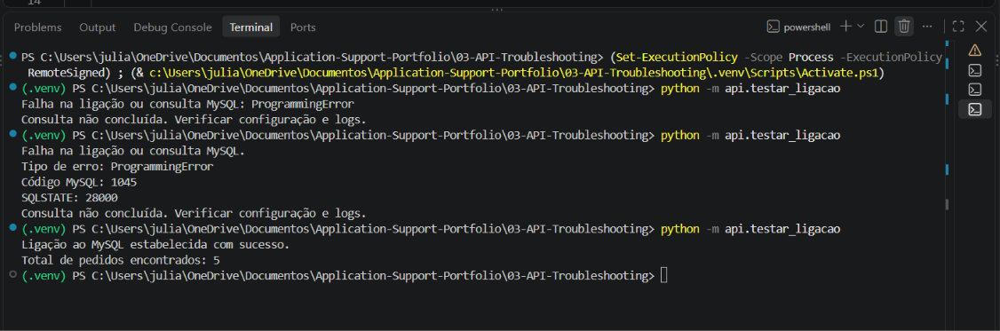

# INC-API-001 — Falha de Autenticação MySQL

## 1. Identificação do Incidente

- **ID:** INC-API-001
- **Categoria:** Falha de autenticação na base de dados
- **Ambiente:** Laboratório local
- **Aplicação:** API de Gestão de Pedidos
- **Tecnologias:** Python, FastAPI e MySQL
- **Estado:** Resolvido

## 2. Descrição do Problema

Durante os testes de integração entre Python e MySQL, a aplicação não conseguiu estabelecer uma ligação autenticada à base de dados `api_troubleshooting_lab`.

A falha ocorreu durante a execução do script `api/testar_ligacao.py`, responsável por verificar a comunicação com o MySQL e consultar o número de pedidos armazenados.

## 3. Comportamento Esperado

O script deveria estabelecer ligação ao MySQL, executar a consulta SQL e devolver o total de cinco pedidos fictícios.

Resultado esperado:

```text
Ligação ao MySQL estabelecida com sucesso.
Total de pedidos encontrados: 5
```

## 4. Comportamento Observado

Durante a primeira execução, foi identificado um erro de autenticação.

```text
Falha na ligação ou consulta MySQL.
Tipo de erro: ProgrammingError
Código MySQL: 1045
SQLSTATE: 28000
Consulta não concluída.
```

O código MySQL 1045 indica que o servidor recusou a autenticação da ligação.

## 5. Investigação e Diagnóstico

Foram realizadas as seguintes verificações:

1. Confirmação de que o MySQL Server estava acessível através do MySQL Workbench.
2. Verificação da conta autenticada com `SELECT CURRENT_USER()`.
3. Identificação da conta administrativa `root@localhost`.
4. Análise da configuração de autenticação utilizada pelo Python.
5. Identificação do erro MySQL 1045 e SQLSTATE 28000.

A configuração inicial do Python utilizava o utilizador `root`, sem uma palavra-passe definida no ficheiro `.env`.

Esta configuração não permitiu autenticar a ligação.

## 6. Causa Identificada

A falha estava relacionada com a autenticação da conta utilizada pela aplicação Python.

A ligação inicial utilizava credenciais que não foram aceites pelo servidor MySQL.

A investigação demonstrou a necessidade de configurar credenciais válidas para a aplicação.

## 7. Correção Aplicada

Foi criado um utilizador MySQL exclusivo para o laboratório:

`api_suporte@localhost`

Foram atribuídas permissões limitadas à base `api_troubleshooting_lab`:

```sql
GRANT SELECT, INSERT, UPDATE
ON api_troubleshooting_lab.*
TO 'api_suporte'@'localhost';
```

O ficheiro `.env` foi atualizado localmente com as credenciais do novo utilizador.

As palavras-passe não foram incluídas no código-fonte nem na documentação publicada.

## 8. Validação da Correção

Após a atualização das credenciais, o teste foi executado novamente:

```powershell
python -m api.testar_ligacao
```

Resultado obtido:

```text
Ligação ao MySQL estabelecida com sucesso.
Total de pedidos encontrados: 5
```

A ligação foi estabelecida e a consulta SQL devolveu os cinco pedidos esperados.

**Resultado:** Correção validada.

## 9. Medidas Preventivas

- Utilizar contas específicas para aplicações, evitando contas administrativas.
- Aplicar o princípio do menor privilégio.
- Guardar credenciais em variáveis de ambiente locais.
- Excluir ficheiros `.env` do controlo de versões.
- Disponibilizar um `.env.example` sem credenciais reais.
- Verificar códigos de erro MySQL durante o diagnóstico.

## 10. Evidência

A captura apresenta o erro de autenticação e a execução bem-sucedida após a correção.

**Ficheiro:** `MYSQL_ERRO_1045_CORRECAO.png`

**Localização:** `../Evidencias/MYSQL_ERRO_1045_CORRECAO.png`



## 11. Conclusão

O incidente foi resolvido através da configuração de uma conta MySQL própria para a aplicação e da atualização das credenciais locais.

A execução após a correção confirmou a comunicação entre Python e MySQL e a possibilidade de consultar os dados armazenados.

**Estado final:** Resolvido e validado.
