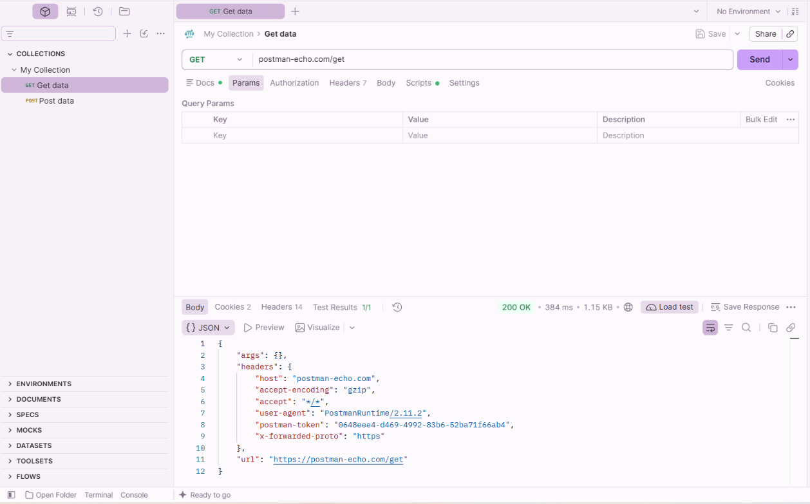

# TESTE-GET-001 — Verificação de Comunicação HTTP

## 1. Objetivo

Verificar a comunicação entre o cliente HTTP (Postman) e uma API pública, analisando o código de estado, o tempo de resposta e os dados devolvidos pelo servidor.

## 2. Ambiente de Teste

- **Ferramenta:** Postman
- **Método HTTP:** GET
- **Endpoint:** https://postman-echo.com/get
- **Autenticação:** Não necessária
- **Formato da resposta:** JSON

## 3. Procedimento

1. Abrir o Postman.
2. Selecionar o método GET.
3. Introduzir o endpoint da API.
4. Executar a requisição através do botão Send.
5. Analisar a resposta HTTP e os dados devolvidos.

## 4. Resultado Esperado

- Código HTTP 200 OK.
- Resposta válida em formato JSON.
- Comunicação estabelecida com sucesso.

## 5. Resultado Obtido

- **Código HTTP:** 200 OK
- **Tempo de resposta:** 384 ms
- **Tamanho da resposta:** 1,15 KB
- **Testes automáticos:** 1/1 aprovado
- **Formato da resposta:** JSON

## 6. Análise Técnica

A requisição GET foi processada com sucesso pelo servidor.

O código HTTP 200 indica que o pedido foi concluído corretamente.

O tempo de resposta observado foi de 384 ms, sem evidências de erro de comunicação nesta execução.

O corpo da resposta apresentou dados estruturados em JSON, incluindo informações relativas à requisição HTTP, como os cabeçalhos (headers) e o endereço do endpoint.

O teste automático configurado no Postman também foi aprovado, confirmando que o código de estado recebido correspondeu ao esperado.

## 7. Conclusão

O teste confirmou que o endpoint respondeu corretamente à requisição GET nas condições verificadas.

Não foram identificadas falhas durante esta execução.

Este procedimento demonstra a utilização do Postman para verificar a comunicação HTTP, analisar respostas de APIs e validar o funcionamento de um endpoint.

**Estado:** Teste aprovado.

## 8. Evidência

A execução do teste foi documentada através de uma captura de ecrã do Postman, apresentando o código HTTP 200 OK e a resposta JSON.

**Ficheiro:** `GET_200_OK.png`

**Localização:** `../Evidencias/GET_200_OK.png`

