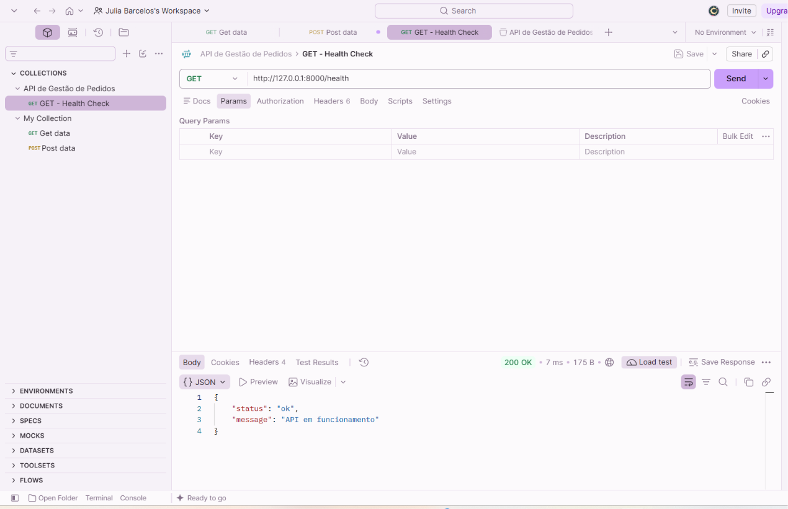

# TESTE-GET-003 — Health Check da API Local

## 1. Objetivo

Verificar a disponibilidade básica e a comunicação HTTP de uma API REST desenvolvida em Python com FastAPI.

O teste pretende confirmar que o servidor local recebe requisições GET e devolve a resposta JSON esperada.

## 2. Ambiente de Teste

- **Aplicação:** API de Gestão de Pedidos
- **Linguagem:** Python
- **Framework:** FastAPI
- **Servidor:** Uvicorn
- **Ferramenta de teste:** Postman
- **Método HTTP:** GET
- **Endpoint:** http://127.0.0.1:8000/health
- **Autenticação:** Não necessária
- **Ambiente:** Local (localhost)

## 3. Procedimento

1. Ativar o ambiente virtual Python.
2. Iniciar o servidor Uvicorn.
3. Confirmar que a aplicação iniciou corretamente.
4. Abrir o Postman.
5. Configurar a requisição GET para o endpoint /health.
6. Executar a requisição através do botão Send.
7. Analisar o código HTTP e a resposta JSON.

## 4. Resultado Esperado

- Código HTTP 200 OK.
- Resposta válida em formato JSON.
- Campo `status` com o valor `ok`.
- Campo `message` com o valor `API em funcionamento`.

## 5. Resultado Obtido

- **Código HTTP:** 200 OK
- **Tempo de resposta:** 5 ms
- **Tamanho da resposta:** 175 B
- **Formato da resposta:** JSON

Resposta recebida:

```json
{
  "status": "ok",
  "message": "API em funcionamento"
}
```

## 6. Análise Técnica

A API foi iniciada com sucesso através do servidor Uvicorn.

O endpoint `/health` recebeu e processou corretamente a requisição GET.

O código HTTP 200 confirmou o processamento bem-sucedido da requisição.

A resposta JSON apresentou os valores esperados, indicando que a aplicação estava a responder corretamente durante o teste.

O tempo de resposta observado foi de 5 ms, correspondente a uma execução num ambiente local.

Este teste permite verificar a disponibilidade básica da aplicação, mas não comprova o funcionamento de bases de dados ou serviços externos.

## 7. Conclusão

O teste confirmou o funcionamento do endpoint `/health` nas condições verificadas.

Não foram identificadas falhas durante a execução.

**Estado:** Teste aprovado.

## 8. Evidência

Captura de ecrã do Postman, apresentando o código HTTP 200 OK e a resposta JSON.

**Ficheiro:** `GET_HEALTH_200_OK.png`

**Localização:** `../Evidencias/GET_HEALTH_200_OK.png`


