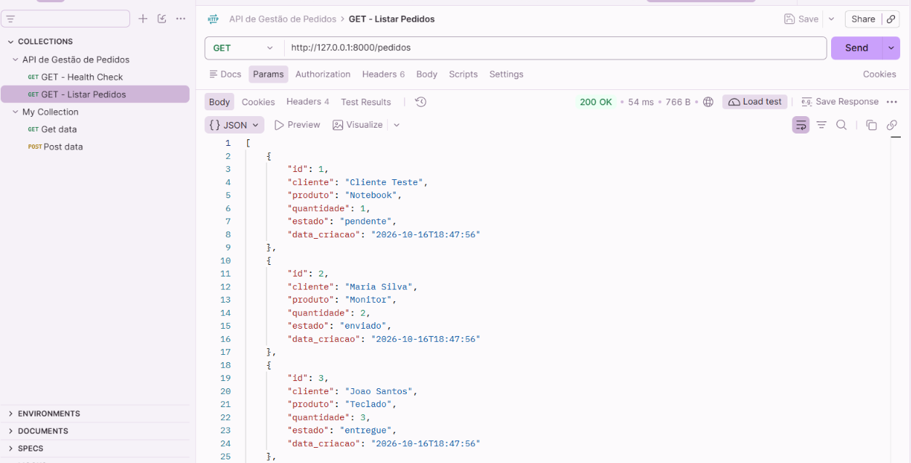

# TESTE-GET-004 — Consulta de Pedidos na Base MySQL

## 1. Objetivo

Validar a comunicação entre Postman, FastAPI e MySQL através de uma requisição HTTP GET.

Verificar se o endpoint `/pedidos` consulta corretamente os registos armazenados na base de dados `api_troubleshooting_lab`.

## 2. Ambiente de Teste

- **Aplicação:** API de Gestão de Pedidos
- **Linguagem:** Python
- **Framework:** FastAPI
- **Servidor:** Uvicorn
- **Base de dados:** MySQL 8.0
- **Tabela:** pedidos
- **Ferramenta:** Postman
- **Método HTTP:** GET
- **Endpoint:** `http://127.0.0.1:8000/pedidos`
- **Ambiente:** Local

## 3. Procedimento

1. Confirmar a existência dos cinco pedidos no MySQL.
2. Iniciar o servidor Uvicorn.
3. Abrir a coleção API de Gestão de Pedidos no Postman.
4. Configurar a requisição GET para o endpoint `/pedidos`.
5. Executar a requisição através do botão Send.
6. Verificar o código HTTP.
7. Analisar os registos devolvidos em formato JSON.
8. Comparar os dados com os registos da base MySQL.

## 4. Resultado Esperado

- Código HTTP 200 OK.
- Resposta válida em formato JSON.
- Lista com cinco pedidos fictícios.
- Identificadores, clientes, produtos, quantidades e estados correspondentes à base de dados.

## 5. Resultado Obtido

- **Código HTTP:** 200 OK
- **Tempo de resposta:** 54 ms
- **Tamanho da resposta:** 766 B
- **Formato:** JSON
- **Total de pedidos:** 5

Foram devolvidos os seguintes pedidos:

| ID | Cliente | Produto | Quantidade | Estado |
|---|---|---|---|---|
| 1 | Cliente Teste | Notebook | 1 | pendente |
| 2 | Maria Silva | Monitor | 2 | enviado |
| 3 | Joao Santos | Teclado | 3 | entregue |
| 4 | Ana Costa | Rato Wireless | 1 | pendente |
| 5 | Pedro Almeida | Impressora | 1 | cancelado |

## 6. Análise Técnica

O endpoint `/pedidos` processou corretamente a requisição HTTP GET.

A aplicação FastAPI utilizou o conector MySQL para estabelecer ligação à base de dados e executar uma consulta SQL.

Os resultados foram devolvidos ao Postman em formato JSON.

O código HTTP 200 confirmou o processamento bem-sucedido da requisição.

O tempo de resposta observado foi de 54 ms, correspondente à execução realizada no ambiente local.

A consulta devolveu os cinco pedidos esperados, demonstrando o funcionamento da comunicação entre os componentes do laboratório.

## 7. Conclusão

O teste confirmou o funcionamento do endpoint GET `/pedidos`, integrado com a base de dados MySQL.

Não foram identificadas falhas nesta execução.

**Estado:** Teste aprovado.

## 8. Evidências

Foram guardadas duas capturas de ecrã para documentar a resposta JSON completa.

### Evidência 1 — Código HTTP e primeiros pedidos

**Ficheiro:** `GET_PEDIDOS_MYSQL_200_OK_01.png`

### Evidência 2 — Restantes pedidos

**Ficheiro:** `GET_PEDIDOS_MYSQL_200_OK_02.png`

