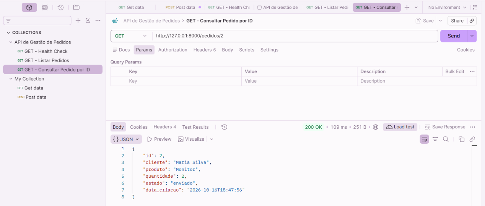

# TESTE-GET-005 — Consulta de Pedido por ID

## 1. Objetivo

Validar a consulta de um pedido específico na base de dados MySQL através do endpoint GET `/pedidos/{pedido_id}` da API FastAPI.

## 2. Ambiente de Teste

- **Aplicação:** API de Gestão de Pedidos
- **Ferramenta:** Postman
- **Linguagem:** Python
- **Framework:** FastAPI
- **Base de dados:** MySQL
- **Método HTTP:** GET
- **Endpoint:** `http://127.0.0.1:8000/pedidos/2`
- **Ambiente:** Local

## 3. Procedimento

1. Confirmar que o servidor Uvicorn estava em execução.
2. Abrir a coleção API de Gestão de Pedidos no Postman.
3. Configurar a requisição GET para `/pedidos/2`.
4. Executar a requisição.
5. Verificar o código HTTP e os dados devolvidos.
6. Comparar a resposta com os dados existentes no MySQL.

## 4. Resultado Esperado

- Código HTTP 200 OK.
- Resposta JSON com um único pedido.
- Identificador igual a 2.
- Dados correspondentes ao registo armazenado no MySQL.

## 5. Resultado Obtido

- **Código HTTP:** 200 OK
- **Tempo de resposta:** 109 ms
- **Tamanho da resposta:** 251 B
- **Estado:** Aprovado

### Dados devolvidos

| Campo | Valor |
|---|---|
| ID | 2 |
| Cliente | Maria Silva |
| Produto | Monitor |
| Quantidade | 2 |
| Estado | enviado |
| Data de criação | 2026-10-16T18:47:56 |

## 6. Análise Técnica

O endpoint recebeu o identificador 2 e executou uma consulta SQL parametrizada à tabela `pedidos`.

A aplicação recuperou o registo correspondente através de `fetchone()` e devolveu os dados em formato JSON.

A resposta HTTP 200 confirmou que a requisição foi processada corretamente.

Os dados obtidos corresponderam ao pedido existente na base MySQL.

## 7. Conclusão

A consulta de pedidos por identificador foi validada com sucesso.

Não foram identificadas falhas nesta execução.

**Estado final:** Teste aprovado.

## 8. Evidência

**Ficheiro:** `GET_PEDIDO_ID_200_OK.png`

