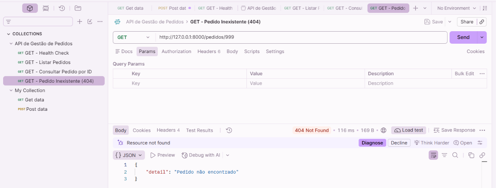

# TESTE-GET-006 — Consulta de Pedido Inexistente (HTTP 404)

## 1. Objetivo

Validar o comportamento da API FastAPI quando é solicitada a consulta de um pedido inexistente na base de dados MySQL.

Confirmar que o endpoint GET `/pedidos/{pedido_id}` devolve HTTP 404 Not Found e uma mensagem adequada quando não encontra o registo solicitado.

## 2. Ambiente de Teste

- **Aplicação:** API de Gestão de Pedidos
- **Ferramenta:** Postman
- **Linguagem:** Python
- **Framework:** FastAPI
- **Base de dados:** MySQL 8.0
- **Tabela:** pedidos
- **Método HTTP:** GET
- **Endpoint:** `http://127.0.0.1:8000/pedidos/999`
- **Ambiente:** Local

## 3. Cenário de Teste

A base de dados do laboratório contém cinco pedidos fictícios, com identificadores de 1 a 5.

Foi utilizado o identificador 999 para simular a consulta de um pedido inexistente.

O objetivo foi verificar se a aplicação consegue reconhecer a ausência do registo e devolver a resposta HTTP apropriada.

## 4. Procedimento

1. Confirmar que o servidor Uvicorn estava em execução.
2. Abrir a coleção API de Gestão de Pedidos no Postman.
3. Criar a requisição GET para `/pedidos/999`.
4. Executar a requisição através do botão Send.
5. Verificar o código HTTP devolvido.
6. Analisar a mensagem apresentada no corpo da resposta.
7. Comparar o resultado com o comportamento previsto no código Python.

## 5. Resultado Esperado

- Código HTTP 404 Not Found.
- Resposta em formato JSON.
- Mensagem indicando que o pedido não foi encontrado.
- Ausência de dados de outros pedidos na resposta.

Resposta esperada:

```json
{
  "detail": "Pedido não encontrado"
}
```

## 6. Resultado Obtido

- **Código HTTP:** 404 Not Found
- **Tempo de resposta:** 116 ms
- **Tamanho da resposta:** 169 B
- **Formato:** JSON
- **Estado:** Aprovado

Resposta obtida:

```json
{
  "detail": "Pedido não encontrado"
}
```

O resultado correspondeu ao comportamento esperado.

## 7. Análise Técnica

O endpoint `/pedidos/{pedido_id}` recebeu o identificador 999 e executou uma consulta SQL parametrizada à tabela `pedidos`.

A instrução SQL procurou o registo correspondente ao identificador recebido.

Como não existia um pedido com esse ID, o método `fetchone()` não devolveu um registo.

A aplicação identificou esta condição e utilizou `HTTPException` para devolver o código HTTP 404 e a mensagem "Pedido não encontrado".

Este resultado demonstra que a API possui tratamento explícito para a ausência de um recurso.

### Interpretação do Código HTTP

O código HTTP 404 indica que o recurso solicitado não foi encontrado.

Neste cenário, não representa uma indisponibilidade da aplicação ou da base de dados.

A API estava operacional e respondeu corretamente à consulta realizada.

Em Suporte Aplicacional, esta distinção é importante para evitar classificar incorretamente comportamentos esperados como incidentes técnicos.

## 8. Comparação com o Teste Anterior

| Cenário | Endpoint | HTTP | Resultado |
|---|---|---|---|
| Pedido existente | GET `/pedidos/2` | 200 OK | Pedido encontrado |
| Pedido inexistente | GET `/pedidos/999` | 404 Not Found | Pedido não encontrado |

Os dois resultados confirmam que o endpoint distingue corretamente pedidos existentes e inexistentes.

## 9. Conclusão

O teste confirmou que a API trata adequadamente a consulta de um pedido inexistente.

O código HTTP 404 e a mensagem devolvida corresponderam ao comportamento esperado.

Não foi identificada uma falha técnica nesta execução.

**Estado final:** Teste aprovado.

## 10. Evidência

**Ficheiro:** `GET_PEDIDO_INEXISTENTE_404.png`



## 11. Referência

Teste relacionado: [TESTE-GET-005 — Consulta de Pedido por ID](TESTE-GET-005.md)
