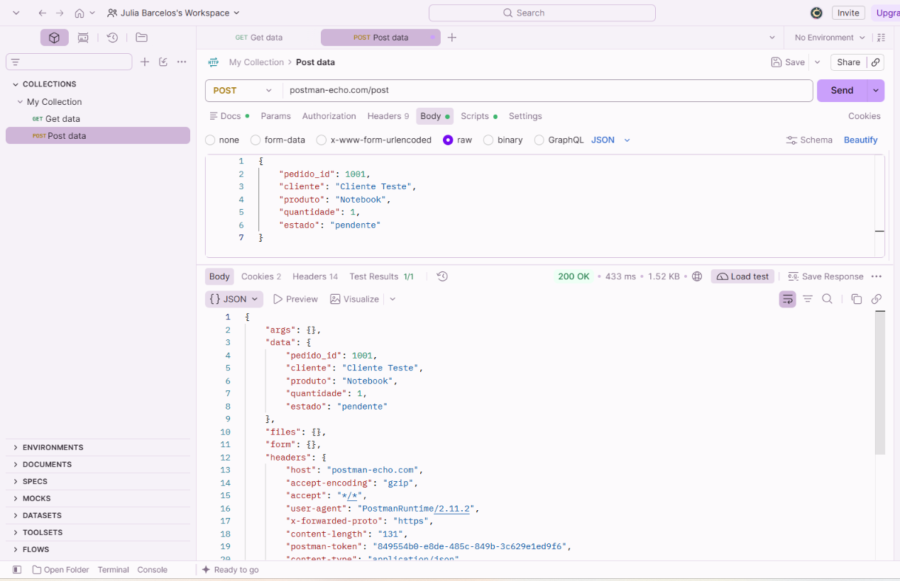

# TESTE-POST-002 — Verificação de Envio de Dados HTTP

## 1. Objetivo

Verificar o envio de dados em formato JSON através de uma requisição HTTP POST, analisando o código de estado, o tempo de resposta e a integridade dos dados devolvidos pela API.

## 2. Ambiente de Teste

- **Ferramenta:** Postman
- **Método HTTP:** POST
- **Endpoint:** https://postman-echo.com/post
- **Autenticação:** Não necessária
- **Formato da requisição:** JSON
- **Formato da resposta:** JSON

## 3. Procedimento

1. Abrir o Postman.
2. Selecionar o método POST.
3. Introduzir o endpoint da API.
4. Selecionar Body → raw → JSON.
5. Inserir os dados fictícios do pedido.
6. Executar a requisição através do botão Send.
7. Analisar o código HTTP e a resposta JSON.

## 4. Dados Enviados

```json
{
  "pedido_id": 1001,
  "cliente": "Cliente Teste",
  "produto": "Notebook",
  "quantidade": 1,
  "estado": "pendente"
}
```

## 5. Resultado Esperado

- Código HTTP 200 OK.
- Resposta válida em formato JSON.
- Dados enviados apresentados corretamente no campo `data`.
- Comunicação HTTP estabelecida com sucesso.

## 6. Resultado Obtido

- **Código HTTP:** 200 OK
- **Tempo de resposta:** 433 ms
- **Tamanho da resposta:** 1,52 KB
- **Testes automáticos:** 1/1 aprovado
- **Formato da resposta:** JSON

## 7. Análise Técnica

A requisição POST foi processada com sucesso pelo servidor.

O código HTTP 200 indica que o endpoint processou corretamente o pedido.

O tempo de resposta observado foi de 433 ms.

O corpo da resposta apresentou os dados enviados no campo `data`, mantendo os valores e os tipos de dados originais.

O teste automático configurado no Postman também foi aprovado.

O Postman Echo funciona como uma API de teste que devolve as informações recebidas. Portanto, o resultado confirma a receção e a devolução dos dados, mas não representa a criação de um pedido numa base de dados.

## 8. Conclusão

O teste confirmou que o endpoint respondeu corretamente à requisição POST nas condições verificadas.

Não foram identificadas falhas durante esta execução.

**Estado:** Teste aprovado.

## 9. Evidência

A execução foi documentada através de uma captura de ecrã do Postman, mostrando o código HTTP 200 OK e a resposta JSON.

**Ficheiro:** `POST_200_OK.png`

**Localização:** `../Evidencias/POST_200_OK.png`


