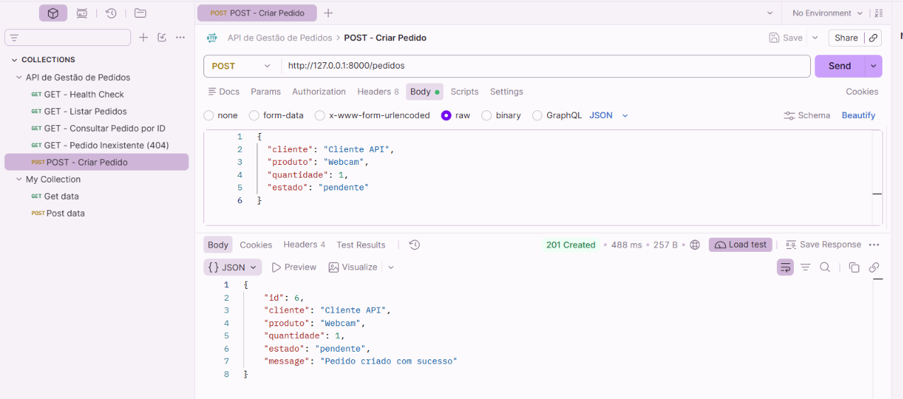
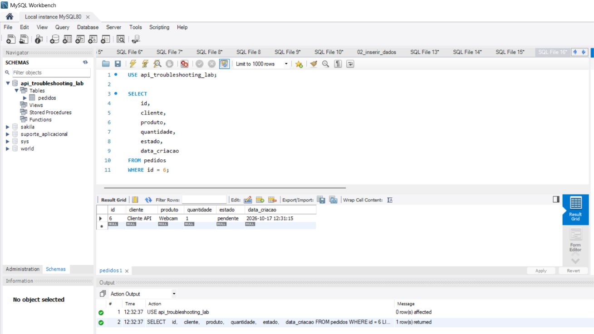

# TESTE-POST-007 — Criação de Pedido com Persistência MySQL

## 1. Objetivo

Validar a criação de um novo pedido através de uma requisição HTTP POST à API FastAPI.

Confirmar que os dados enviados pelo Postman são recebidos, validados e armazenados corretamente na base de dados MySQL.

## 2. Ambiente de Teste

- **Aplicação:** API de Gestão de Pedidos
- **Ferramentas:** Postman e MySQL Workbench
- **Linguagem:** Python
- **Framework:** FastAPI
- **Servidor:** Uvicorn
- **Base de dados:** MySQL 8.0
- **Base:** `api_troubleshooting_lab`
- **Tabela:** `pedidos`
- **Método HTTP:** POST
- **Endpoint:** `http://127.0.0.1:8000/pedidos`
- **Ambiente:** Local

## 3. Cenário de Teste

A base de dados continha inicialmente cinco pedidos fictícios.

Foi preparada uma requisição HTTP POST para criar um novo pedido com os seguintes dados:

```json
{
  "cliente": "Cliente API",
  "produto": "Webcam",
  "quantidade": 1,
  "estado": "pendente"
}
```

O objetivo foi verificar se a API conseguia inserir o registo na tabela MySQL e devolver uma resposta HTTP adequada.

## 4. Procedimento

1. Confirmar que o servidor Uvicorn estava em execução.
2. Abrir a coleção API de Gestão de Pedidos no Postman.
3. Criar uma requisição POST para `/pedidos`.
4. Selecionar `Body > raw > JSON`.
5. Introduzir os dados fictícios do pedido.
6. Executar a requisição uma única vez.
7. Verificar o código HTTP e o conteúdo da resposta.
8. Abrir o MySQL Workbench.
9. Consultar a tabela `pedidos` para confirmar a persistência do novo registo.

## 5. Resultado Esperado

- Código HTTP 201 Created.
- Resposta JSON com os dados do pedido criado.
- Identificador gerado automaticamente pelo MySQL.
- Mensagem de confirmação.
- Novo registo armazenado na tabela `pedidos`.

## 6. Resultado Obtido

- **Código HTTP:** 201 Created
- **Tempo de resposta:** 488 ms
- **Tamanho da resposta:** 257 B
- **Novo identificador:** 6
- **Formato:** JSON
- **Estado:** Aprovado

### Resposta Obtida

```json
{
  "id": 6,
  "cliente": "Cliente API",
  "produto": "Webcam",
  "quantidade": 1,
  "estado": "pendente",
  "message": "Pedido criado com sucesso"
}
```

A resposta apresentou o identificador 6, gerado pelo MySQL, e confirmou a criação do pedido.

## 7. Validação da Persistência no MySQL

Após a execução da requisição POST, foi realizada uma consulta no MySQL Workbench.

### Consulta SQL

```sql
USE api_troubleshooting_lab;

SELECT
    id,
    cliente,
    produto,
    quantidade,
    estado,
    data_criacao
FROM pedidos
WHERE id = 6;
```

### Resultado Obtido

| Campo | Valor |
|---|---|
| ID | 6 |
| Cliente | Cliente API |
| Produto | Webcam |
| Quantidade | 1 |
| Estado | pendente |
| Data de criação | 2026-10-17 12:31:15 |

A consulta devolveu o registo de ID 6, confirmando que os dados foram efetivamente armazenados no MySQL.

## 8. Análise Técnica

O endpoint POST `/pedidos` recebeu os dados enviados pelo Postman em formato JSON.

A aplicação utilizou um modelo Pydantic para validar os campos recebidos.

Após a validação, foi estabelecida uma ligação ao MySQL através do módulo `api.database`.

A API executou uma instrução SQL `INSERT INTO pedidos` com parâmetros, evitando a construção da consulta através da concatenação direta dos valores recebidos.

Em seguida, o método `commit()` confirmou a transação e `lastrowid` permitiu recuperar o identificador criado.

O FastAPI devolveu o código HTTP 201 Created, indicando a criação do recurso.

A consulta posterior no MySQL Workbench confirmou a persistência dos dados.

## 9. Conclusão

O teste demonstrou o funcionamento completo do processo de criação de pedidos:

Postman → FastAPI → INSERT SQL → MySQL.

O registo foi criado com sucesso e a sua persistência foi validada diretamente na base de dados.

Não foram identificadas falhas nesta execução.

**Estado final:** Teste aprovado.

## 10. Evidências

### Evidência 1 — Criação do Pedido no Postman

**Ficheiro:** `POST_PEDIDO_201_CREATED.png`



### Evidência 2 — Validação da Persistência no MySQL

**Ficheiro:** `MYSQL_VALIDACAO_POST_PEDIDO_ID_6.png`



## 11. Próximas Validações

- Testar o envio de uma quantidade inválida.
- Verificar o comportamento HTTP 422.
- Confirmar que dados inválidos não são gravados.
- Implementar testes automáticos no Postman.
