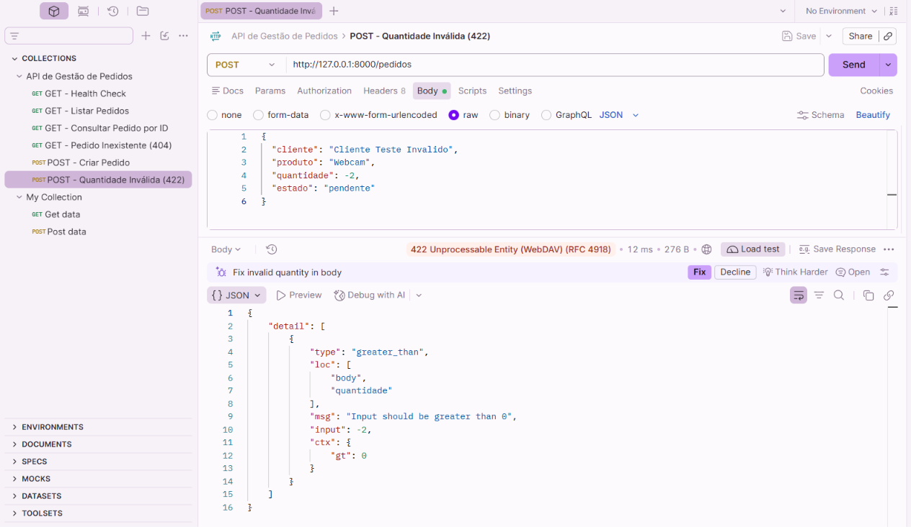
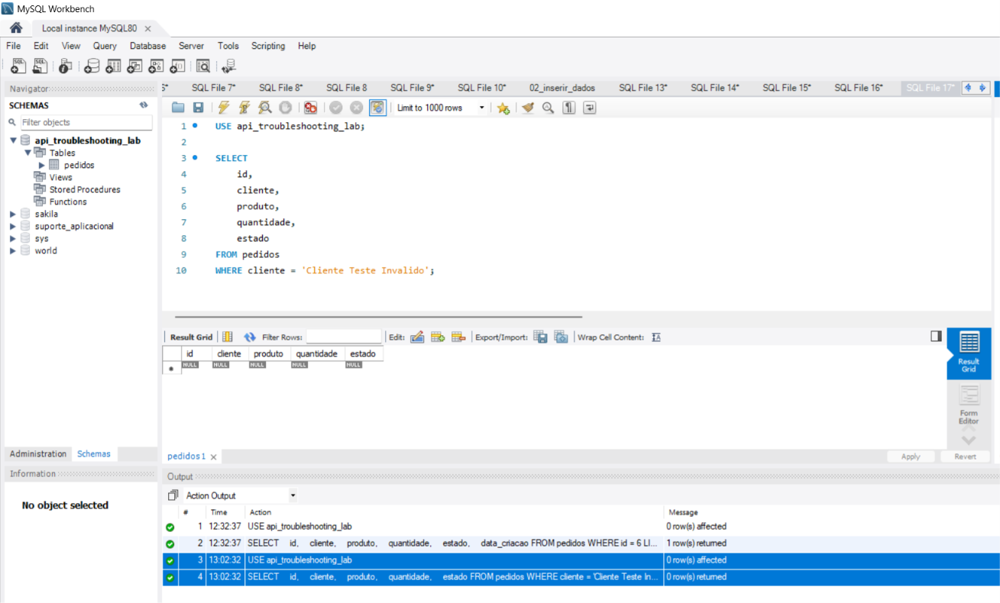

# TESTE-POST-008 — Validação de Quantidade Inválida (HTTP 422)

## 1. Objetivo

Validar o comportamento da API FastAPI quando recebe uma requisição HTTP POST com uma quantidade inválida.

Confirmar que a aplicação rejeita valores negativos e impede a inserção de dados inválidos na base de dados MySQL.

## 2. Ambiente de Teste

- **Aplicação:** API de Gestão de Pedidos
- **Ferramentas:** Postman e MySQL Workbench
- **Linguagem:** Python
- **Framework:** FastAPI
- **Validação:** Pydantic
- **Servidor:** Uvicorn
- **Base de dados:** MySQL 8.0
- **Base:** `api_troubleshooting_lab`
- **Tabela:** `pedidos`
- **Método HTTP:** POST
- **Endpoint:** `http://127.0.0.1:8000/pedidos`
- **Ambiente:** Local

## 3. Cenário de Teste

Foi preparada uma requisição HTTP POST com uma quantidade negativa.

### Dados Enviados

```json
{
  "cliente": "Cliente Teste Invalido",
  "produto": "Webcam",
  "quantidade": -2,
  "estado": "pendente"
}
```

O campo `quantidade` recebeu o valor `-2`, que viola a regra de validação definida no modelo Pydantic.

A aplicação exige que a quantidade seja superior a zero.

## 4. Procedimento

1. Confirmar que o servidor Uvicorn estava em execução.
2. Abrir a coleção API de Gestão de Pedidos no Postman.
3. Criar uma requisição POST para `/pedidos`.
4. Selecionar `Body > raw > JSON`.
5. Introduzir os dados com quantidade negativa.
6. Executar a requisição através do botão Send.
7. Verificar o código HTTP devolvido.
8. Analisar a mensagem de erro no corpo da resposta.
9. Consultar o MySQL para verificar se o pedido inválido foi armazenado.

## 5. Resultado Esperado

- Código HTTP 422.
- Resposta JSON com detalhes sobre o erro de validação.
- Identificação do campo `quantidade`.
- Indicação de que o valor deve ser superior a zero.
- Nenhuma inserção de pedido inválido no MySQL.

## 6. Resultado Obtido

- **Código HTTP:** 422 Unprocessable Entity
- **Tempo de resposta:** 12 ms
- **Tamanho da resposta:** 276 B
- **Formato:** JSON
- **Estado:** Aprovado

### Resposta Obtida

```json
{
  "detail": [
    {
      "type": "greater_than",
      "loc": [
        "body",
        "quantidade"
      ],
      "msg": "Input should be greater than 0",
      "input": -2,
      "ctx": {
        "gt": 0
      }
    }
  ]
}
```

A API identificou corretamente o campo inválido e devolveu uma mensagem de validação.

## 7. Validação na Base de Dados

Após o teste no Postman, foi realizada uma consulta no MySQL Workbench.

### Consulta SQL

```sql
USE api_troubleshooting_lab;

SELECT
    id,
    cliente,
    produto,
    quantidade,
    estado
FROM pedidos
WHERE cliente = 'Cliente Teste Invalido';
```

### Resultado Obtido

A consulta não devolveu nenhum registo correspondente ao cliente utilizado no teste.

**Total de registos encontrados:** 0.

A ausência de resultados confirmou que o pedido inválido não foi armazenado no MySQL.

## 8. Análise Técnica

O endpoint POST `/pedidos` utiliza um modelo Pydantic para validar os dados recebidos.

O campo `quantidade` foi definido com a restrição `gt=0`, exigindo um valor superior a zero.

Ao receber o valor `-2`, o FastAPI identificou uma falha de validação antes de executar a função responsável pela inserção do pedido.

Por esse motivo, a aplicação devolveu HTTP 422, sem executar a instrução SQL INSERT.

A consulta posterior ao MySQL confirmou que não existia qualquer registo com os dados utilizados no teste.

### Interpretação do HTTP 422

O código HTTP 422 indica que o servidor compreendeu a requisição, mas não conseguiu processar os dados de acordo com as regras de validação definidas.

Neste cenário, o código 422 representa um comportamento esperado da aplicação.

Não foi identificada uma falha técnica.

## 9. Comparação com o Teste Anterior

| Cenário | Teste | Código HTTP | Resultado |
|---|---|---|---|
| Quantidade válida | TESTE-POST-007 | 201 Created | Pedido criado |
| Quantidade inválida | TESTE-POST-008 | 422 | Pedido rejeitado |

Esta comparação demonstra que a API aceita dados válidos e rejeita valores que não respeitam as regras estabelecidas.

## 10. Conclusão

O teste confirmou o funcionamento da validação de dados no endpoint POST `/pedidos`.

A API identificou a quantidade negativa, devolveu HTTP 422 e impediu a criação do pedido inválido.

A verificação no MySQL confirmou a ausência do registo.

**Estado final:** Teste aprovado.

## 11. Evidências

### Evidência 1 — Rejeição no Postman

**Ficheiro:** `POST_QUANTIDADE_INVALIDA_422.png`



### Evidência 2 — Confirmação no MySQL

**Ficheiro:** `MYSQL_VALIDACAO_SEM_INSERCAO_422.png`



## 12. Referências

- [TESTE-POST-007 — Criação de Pedido com Persistência MySQL](TESTE-POST-007.md)
- [Código-fonte da API](../api/main.py)

## 13. Próximas Validações

- Testar outros campos obrigatórios.
- Criar testes automáticos no Postman.
- Investigar novos cenários de erros HTTP.
- Documentar as validações e evidências correspondentes.
