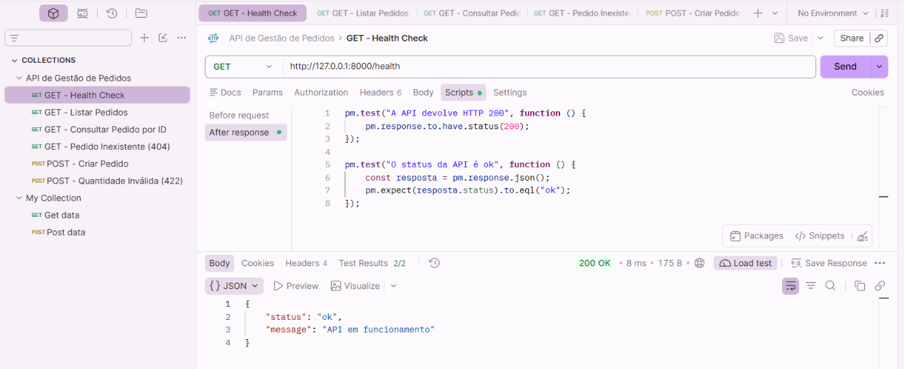
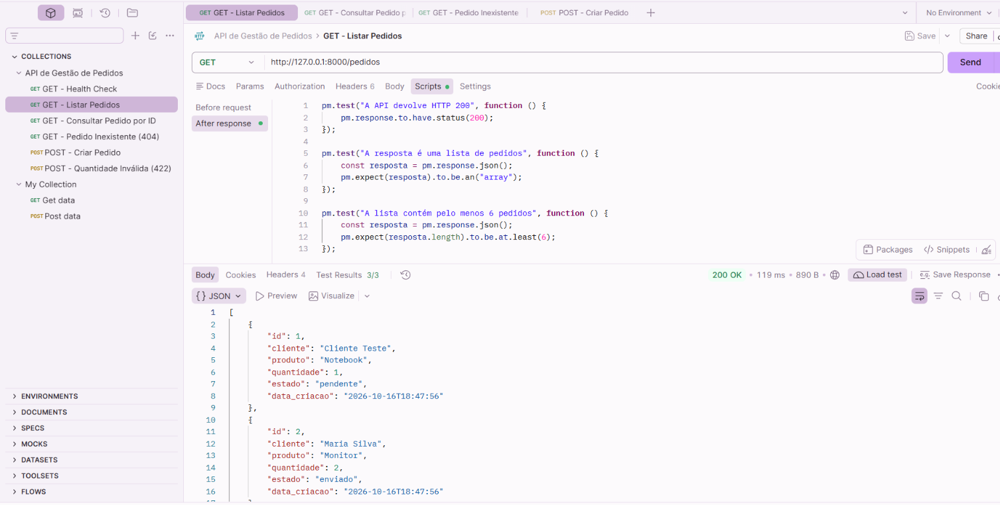
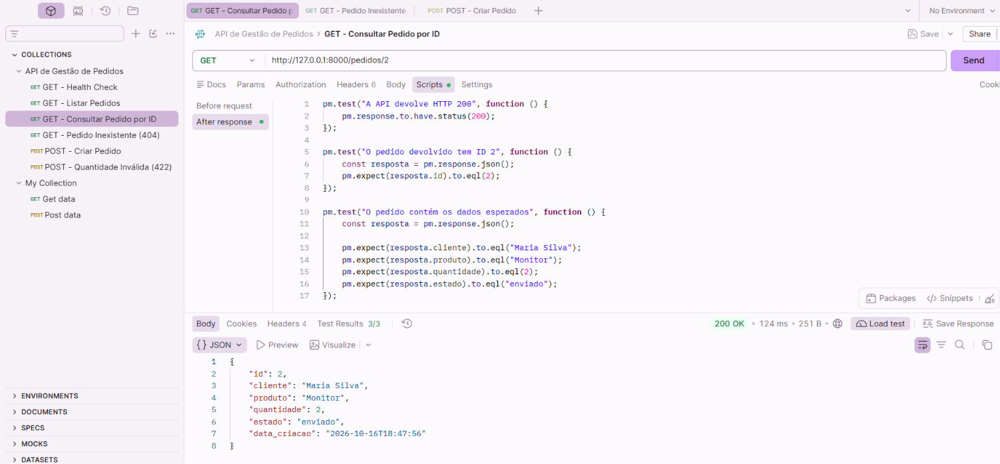
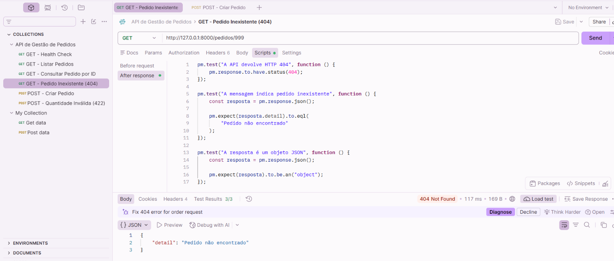
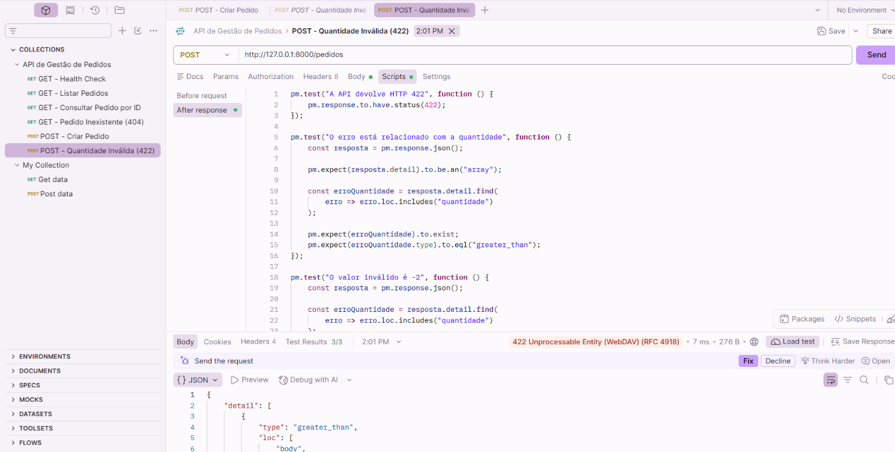
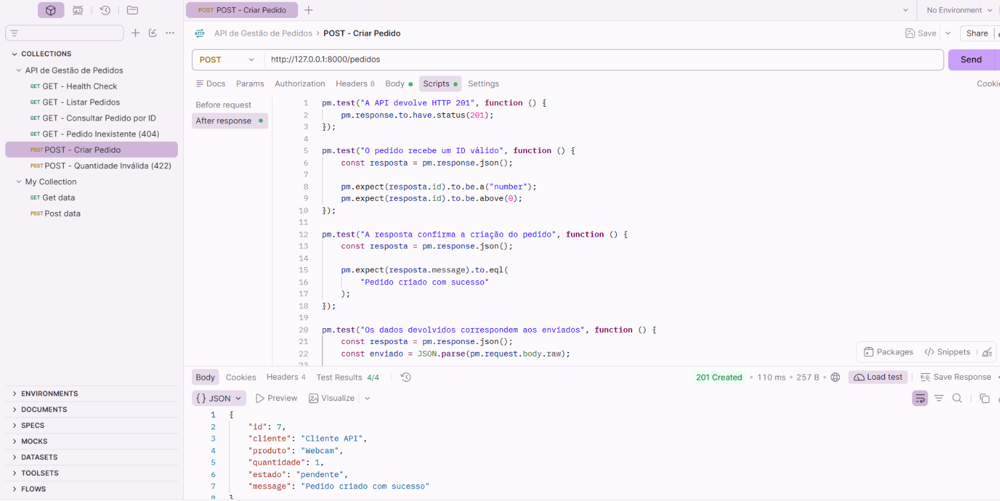
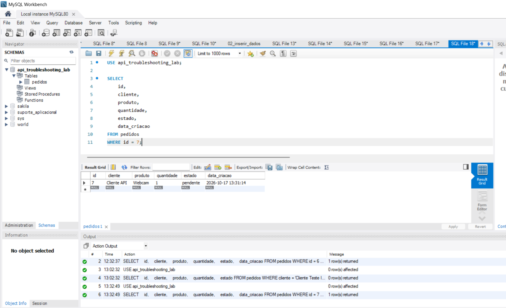

# TESTES-AUTOMATICOS-001 — Validação Automatizada da API REST

## 1. Objetivo

Implementar e executar testes automáticos no Postman para validar os principais comportamentos da API de Gestão de Pedidos.

Verificar as respostas HTTP, a estrutura dos dados devolvidos, as regras de validação e a criação de pedidos na base de dados MySQL.

## 2. Ambiente de Teste

- **Aplicação:** API de Gestão de Pedidos
- **Ferramenta:** Postman
- **Linguagem dos testes:** JavaScript
- **API:** Python + FastAPI
- **Validação de dados:** Pydantic
- **Base de dados:** MySQL 8.0
- **Servidor:** Uvicorn
- **Endereço base:** `http://127.0.0.1:8000`
- **Ambiente:** Local
- **Coleção Postman:** API de Gestão de Pedidos

## 3. Metodologia

Foram criados scripts JavaScript na secção `Scripts > After response` das requisições do Postman.

Os testes utilizam `pm.test()` e `pm.expect()` para comparar os resultados obtidos com os comportamentos esperados.

Foram validadas seis requisições, incluindo consultas bem-sucedidas, criação de pedidos e respostas HTTP esperadas para recursos inexistentes e dados inválidos.

## 4. Resumo dos Resultados

| Requisição | HTTP | Testes aprovados | Estado |
|---|---|---|---|
| GET /health | 200 | 2/2 | Aprovado |
| GET /pedidos | 200 | 3/3 | Aprovado |
| GET /pedidos/2 | 200 | 3/3 | Aprovado |
| GET /pedidos/999 | 404 | 3/3 | Aprovado |
| POST /pedidos — quantidade inválida | 422 | 3/3 | Aprovado |
| POST /pedidos — criação válida | 201 | 4/4 | Aprovado |
| **Total** | | **18/18** | **Aprovado** |

Os 18 testes passaram nas execuções individuais observadas.

## 5. Teste Automático — GET /health

**Endpoint:** `GET http://127.0.0.1:8000/health`

**Resultado:** HTTP 200 OK

**Tempo de resposta:** 8 ms

**Testes aprovados:** 2/2

### Verificações

1. Confirmar que a API devolve HTTP 200.
2. Confirmar que o campo `status` contém o valor `ok`.

### Resultado

Os dois testes foram aprovados.

O endpoint respondeu corretamente e devolveu o estado esperado da aplicação.

### Evidência

## 6. Teste Automático — GET /pedidos

**Endpoint:** `GET http://127.0.0.1:8000/pedidos`

**Resultado:** HTTP 200 OK

**Tempo de resposta:** 119 ms

**Testes aprovados:** 3/3

### Verificações

1. Confirmar que a API devolve HTTP 200.
2. Confirmar que a resposta JSON é uma lista.
3. Confirmar que a lista contém pelo menos seis pedidos.

### Resultado

Os três testes foram aprovados.

A aplicação devolveu uma lista JSON com os pedidos existentes no MySQL.

### Evidência

## 7. Teste Automático — GET /pedidos/2

**Endpoint:** `GET http://127.0.0.1:8000/pedidos/2`

**Resultado:** HTTP 200 OK

**Tempo de resposta:** 124 ms

**Testes aprovados:** 3/3

### Verificações

1. Confirmar que a API devolve HTTP 200.
2. Confirmar que o identificador devolvido é 2.
3. Confirmar os dados esperados do pedido:
   - Cliente: Maria Silva
   - Produto: Monitor
   - Quantidade: 2
   - Estado: enviado

### Resultado

Os três testes foram aprovados.

A API devolveu corretamente o pedido solicitado.

### Evidência

## 8. Teste Automático — GET /pedidos/999

**Endpoint:** `GET http://127.0.0.1:8000/pedidos/999`

**Resultado:** HTTP 404 Not Found

**Tempo de resposta:** 117 ms

**Testes aprovados:** 3/3

### Verificações

1. Confirmar que a API devolve HTTP 404.
2. Confirmar que a mensagem é `Pedido não encontrado`.
3. Confirmar que a resposta é um objeto JSON.

### Resultado

Os três testes foram aprovados.

O código HTTP 404 corresponde ao comportamento esperado para um pedido inexistente.

Esta resposta não foi classificada como falha técnica da aplicação.

### Evidência

## 9. Teste Automático — POST /pedidos com quantidade inválida

**Endpoint:** `POST http://127.0.0.1:8000/pedidos`

**Resultado:** HTTP 422 Unprocessable Entity

**Tempo de resposta:** 5 ms na execução utilizada para validação

**Testes aprovados:** 3/3

### Cenário

Foi enviada uma quantidade negativa:

`"quantidade": -2`

### Verificações

1. Confirmar que a API devolve HTTP 422.
2. Confirmar que o erro está relacionado com o campo `quantidade`.
3. Confirmar que o valor inválido identificado é `-2`.

### Resultado

Os três testes foram aprovados.

A API identificou corretamente a violação da regra de validação `gt=0`.

A ausência de inserção para este cenário já tinha sido confirmada no TESTE-POST-008.

### Evidências

## 10. Teste Automático — POST /pedidos com dados válidos

**Endpoint:** `POST http://127.0.0.1:8000/pedidos`

**Resultado:** HTTP 201 Created

**Tempo de resposta:** 110 ms

**Testes aprovados:** 4/4

### Verificações

1. Confirmar que a API devolve HTTP 201.
2. Confirmar que o novo pedido recebe um identificador numérico positivo.
3. Confirmar a mensagem `Pedido criado com sucesso`.
4. Confirmar que os dados devolvidos correspondem aos enviados.

### Resultado

Os quatro testes foram aprovados.

A API criou um novo pedido com os seguintes dados:

| Campo | Valor |
|---|---|
| ID | 7 |
| Cliente | Cliente API |
| Produto | Webcam |
| Quantidade | 1 |
| Estado | pendente |

### Validação no MySQL

Foi executada uma consulta SQL no MySQL Workbench para confirmar a persistência do pedido:

    USE api_troubleshooting_lab;

    SELECT
        id,
        cliente,
        produto,
        quantidade,
        estado,
        data_criacao
    FROM pedidos
    WHERE id = 7;

A consulta devolveu um registo com os dados esperados.

**Data de criação:** 2026-10-17 13:31:14

O resultado confirmou que o pedido ficou armazenado na base de dados.

### Evidências

## 11. Análise Técnica

Os testes automáticos permitiram verificar o comportamento da API através de critérios objetivos e repetíveis.

Foram validados:

- Códigos HTTP esperados.
- Estrutura das respostas JSON.
- Valores devolvidos pelos endpoints.
- Consulta de pedidos existentes.
- Tratamento de pedidos inexistentes.
- Validação de quantidades inválidas.
- Criação de pedidos através de HTTP POST.
- Persistência dos dados criados no MySQL.

As respostas HTTP 404 e 422 foram consideradas resultados aprovados porque correspondem aos comportamentos esperados nos respetivos cenários.

A execução do POST válido foi realizada de forma controlada, uma vez que cada requisição bem-sucedida cria um novo registo na base de dados.

## 12. Limitações e Melhorias Futuras

Os testes foram executados individualmente no Postman.

Ainda não foi realizada uma execução automatizada da coleção completa através do Collection Runner.

A verificação de quantidade mínima de pedidos depende dos dados presentes na base de dados local.

Os testes de criação de pedidos também alteram o estado da base de dados e deverão ser executados de forma controlada.

Melhorias previstas:

- Exportação e publicação da coleção Postman.
- Organização de execuções repetíveis.
- Utilização de variáveis de ambiente.
- Estratégia de preparação e limpeza de dados de teste.
- Validação adicional de erros e logs.

## 13. Conclusão

A implementação dos testes automáticos no Postman foi concluída com sucesso.

Foram configuradas e validadas 18 verificações automáticas, distribuídas por seis requisições HTTP.

**Resultado final: 18/18 testes aprovados nas execuções individuais.**

A atividade demonstrou competências de validação automatizada de APIs REST, interpretação de respostas HTTP, utilização de JavaScript no Postman e verificação de persistência no MySQL.

**Estado final:** Aprovado.

## 14. Relatórios Relacionados

- [TESTE-GET-003 — Health Check](TESTE-GET-003.md)
- [TESTE-GET-004 — Consulta de Pedidos](TESTE-GET-004.md)
- [TESTE-GET-005 — Consulta por ID](TESTE-GET-005.md)
- [TESTE-GET-006 — Pedido Inexistente](TESTE-GET-006.md)
- [TESTE-POST-007 — Criação de Pedido](TESTE-POST-007.md)
- [TESTE-POST-008 — Quantidade Inválida](TESTE-POST-008.md)
